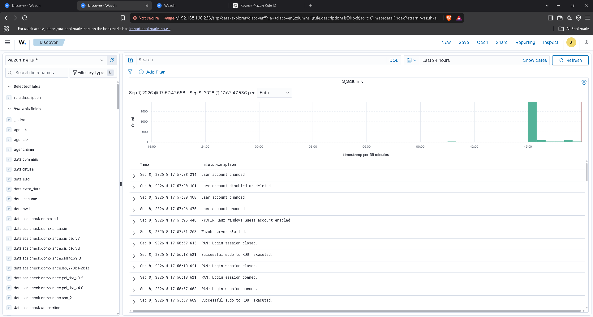
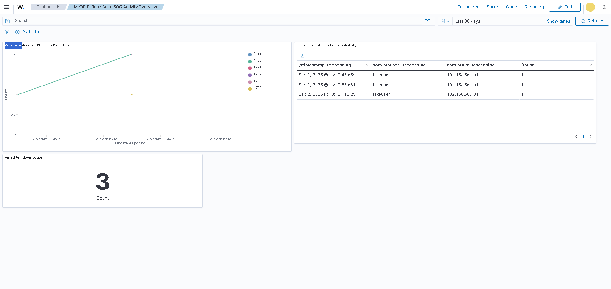

# Wazuh-SIEM-homelab
A hands-on Wazuh SIEM homelab documenting security monitoring, alert investigation, and detection engineering.
# Wazuh SIEM Homelab – SOC Investigation

## Project Overview

This project documents a hands-on Wazuh SIEM homelab built to practice security monitoring, event investigation, authentication monitoring, and automated response.

The lab involved generating controlled security events across Windows and Ubuntu virtual machines, monitoring the activity through a centralized Wazuh server, and investigating the resulting alerts and logs.

This project was completed as part of the **MYDFIR Wazuh SOC Analyst Challenge**.

## Lab Environment

| Component | Description |
|---|---|
| SIEM | Wazuh |
| Endpoints | Windows VM and Ubuntu VM |
| Virtualization | Oracle VirtualBox |
| Monitoring | Wazuh Dashboard and Discover |
| Endpoint telemetry | Windows Event Logs and Linux authentication logs |

## Objectives

- Monitor and investigate authentication-related events.
- Detect repeated failed SSH authentication attempts.
- Configure and test Wazuh Active Response.
- Monitor Windows account-management activity.
- Observe file creation and deletion activity.
- Review and document security events using Wazuh.

## Security Scenarios

### 1. SSH Authentication Monitoring

Generated three consecutive failed SSH authentication attempts from the Windows VM toward the Ubuntu VM.

Wazuh collected the authentication events and displayed them through its monitoring interface.

An Active Response rule was configured to respond after the third failed attempt, demonstrating an automated response mechanism in a controlled environment.

### 2. Windows Account Monitoring

Generated Windows account-management activity, including enabling the Guest account.

Wazuh recorded the account-related events, allowing them to be reviewed through the dashboard and event search.

### 3. File Activity Monitoring

Created and deleted a test file to observe file activity monitoring through Wazuh.

The exercise demonstrated how endpoint file activity can be collected and reviewed during an investigation.

## Screenshots

### SOC Activity Overview

The dashboard provides a centralized view of Windows account changes, Linux failed authentication activity, and failed Windows logons.

### Event Investigation

The Discover interface displays collected security events, timestamps, and event descriptions for further investigation.

## Investigation Report

The full investigation report, including findings, investigation summary, timeline, recommendations, and conclusion, is available here:

[MYDFIR Wazuh SOC Investigation Report](documentation/MYDFIR-Wazuh-SOC-Investigation-Report.pdf)

## Key Takeaways

Through this exercise, I gained practical experience with:

- Centralized security event monitoring using Wazuh.
- Investigating authentication failures and account-management activity.
- Reviewing Windows and Linux security telemetry.
- Understanding automated response mechanisms.
- Monitoring endpoint file activity.
- Documenting investigation findings and recommendations.

## Disclaimer

All activities documented in this repository were intentionally generated within a controlled virtual lab environment for educational purposes. No real-world systems were targeted or compromised.
